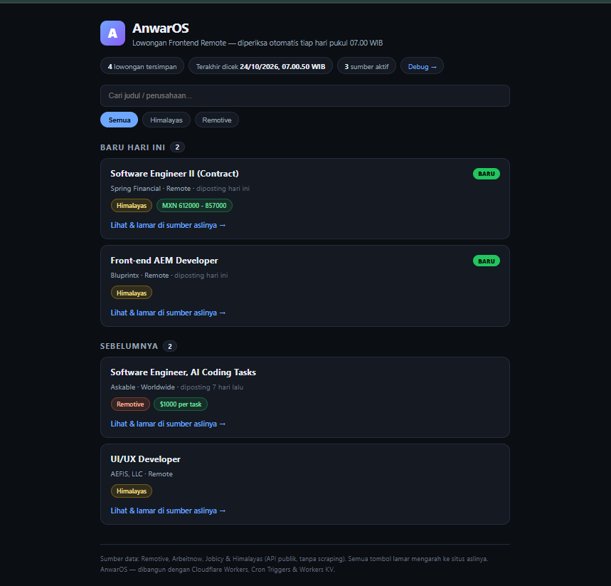

# AnwarOS — Personal Job Watcher on Cloudflare Workers

A personal automation that watches remote front-end job boards for me, every day at 07:00 WIB — even when my laptop is off. It runs entirely on Cloudflare's free tier.

**🔗 Live demo:** https://anwaros.anwarfebrian.workers.dev

**Live concept:** a single Worker fetches public job APIs, filters them with my own rules (front-end / React / JavaScript, junior-friendly, remote-only, no senior/lead roles, no blockchain/web3), marks listings it has never seen before as **BARU** (new) using Workers KV as its memory, accumulates up to 50 listings on the homepage, and serves the result as a simple web page. A `/debug` page shows per-source raw and passed counts, including fetch failures.

## How it works

| Part | What it does |
|---|---|
| **Worker** (`src/worker.js`) | The brain — one JavaScript file: fetch → filter → dedupe → render |
| **Cron Trigger** | The alarm — runs the Worker daily at 00:00 UTC (07:00 WIB) |
| **Workers KV** | The notebook — remembers seen job IDs with just 2 writes per run |

## Data sources (public APIs, no scraping, no API keys)

- [Remotive](https://remotive.com/api/remote-jobs) — listings are credited and every card links back to the original posting; the API is called only once per day.
- [Arbeitnow](https://www.arbeitnow.com/api/job-board-api) — free public job-board API; only `remote: true` listings are kept.
- [Jobicy](https://jobicy.com/api/v2/remote-jobs) — free public API; listings are credited and linked back to the original posting.
- [Himalayas](https://himalayas.app/jobs/api) — free public API; apply buttons go to the original `applicationLink`.

## Endpoints

- `/` — the accumulated list (up to 50) as a web page
- `/run` — trigger a watch run manually (for testing)
- `/api` — the accumulated list plus last-run stats as JSON
- `/debug` — per-source diagnostics: raw counts, filter pass counts, fetch failures

## Tech

JavaScript · Cloudflare Workers · Cron Triggers · Workers KV · Fetch API

## Deploy

Step-by-step instructions (in Bahasa Indonesia) live in [`PANDUAN-DEPLOY.md`](./PANDUAN-DEPLOY.md).

---

Built by Anwar Febrian — fresh graduate in Informatics Engineering, front-end developer.
Portfolio: https://anwarfebrian1208.github.io/
